<p align="center">
  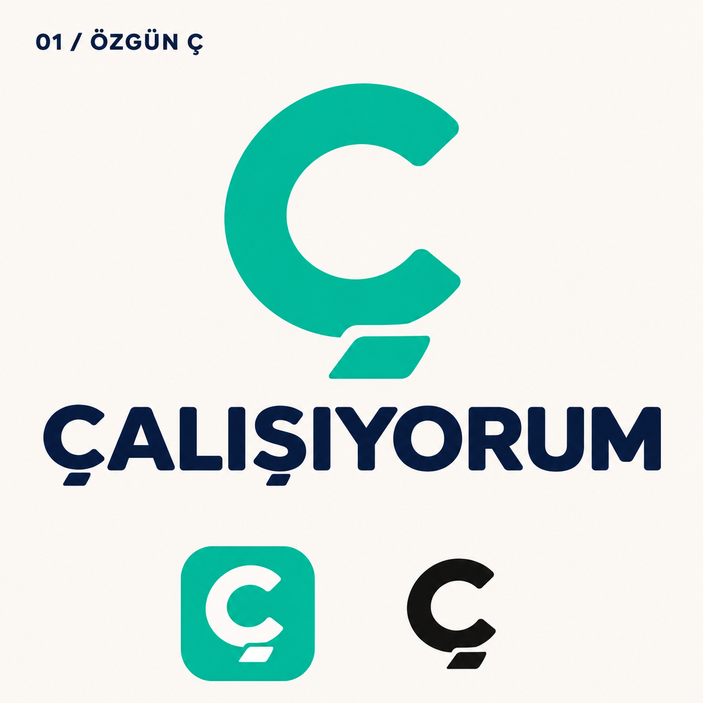
</p>

<h3 align="center">Yüzlerce ilan okuma. Sana uyanlar seni bulsun.</h3>

<p align="center">
  Yapay zekâ destekli kariyer koçu ve iş/staj eşleştirme platformu.<br>
  <b>Canlı demo:</b> <a href="https://calisiyorum.mehmetakifgunhan.com">calisiyorum.mehmetakifgunhan.com</a>
  · <b>Sunum:</b> <a href="sunum/calisiyorum-sunum.pdf">PDF</a>
</p>

<p align="center">
  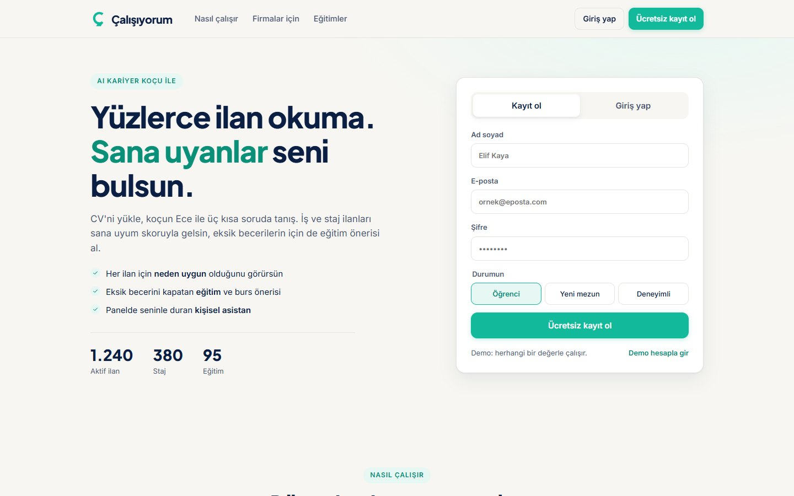
</p>

---

## İçindekiler

- [Sorun](#sorun)
- [Çözüm](#çözüm)
- [Ürün turu](#ürün-turu)
- [Sunum](#sunum)
- [Teknik yapı](#teknik-yapı)
- [Yerelde çalıştırma](#yerelde-çalıştırma)
- [Yayın (Coolify)](#yayın-coolify)
- [Ekip](#ekip)

## Sorun

**Aday tarafı:** Gençler ve yeni mezunlar yüzlerce ilanı tek tek okuyor, nereye uygun olduğunu bilmeden toplu başvuru yapıyor, eksik becerisini neyle kapatacağını bilmiyor.

**İşveren tarafı:** Firmalar çok başvuru alıyor ama uygun aday az. Başvuru seli içinde doğru kişiyi bulmak zaman ve para kaybı.

İki tarafın sorunu birbirini besliyor: aday toplu başvurdukça işverenin yükü artıyor, işveren eledikçe aday daha çok başvuruyor.

## Çözüm

Çalışıyorum işe adayı tanıyarak başlar:

| | Ne yapar |
|---|---|
| **AI kariyer koçu "Ece"** | CV'yi okur, becerileri çıkarır, üç kısa soruyla hedefi, şehri ve iş tipini öğrenir. Panelde sürekli yanında durur. |
| **Akıllı eşleştirme** | Her ilan için uyum skoru hesaplar ve **neden uygun olduğunu** açıklar (zorunlu beceriler, seviye, konum). |
| **Eksiğini kapat** | Hedef ilan için eksik becerileri gösterir, bunları kapatan eğitim ve burs önerir. |
| **İşveren paneli** *(planlanıyor, sunumda)* | Firmalar başvuru seli yerine ön eşleşmiş, uygun adayları görür. |

**Gelir modeli:** Ücretli eğitimler, firma ilan ücreti, sponsorluklar.

## Ürün turu

> Demodaki bütün ilanlar, firmalar, eğitimler ve kişiler kurgusaldır. Koç sohbeti canlı olarak **Gemini 2.5 Flash** ile çalışır.

### 1. Kayıt ve CV

Aday kayıt olur, CV'sini (PDF/TXT) yükler ya da örnek bir CV seçer. CV okunur ve beceriler çıkarılır.

<table>
  <tr>
    <td></td>
    <td></td>
  </tr>
</table>

### 2. Koç Ece ile tanışma

Ece, CV'ye bakarak üç kısa soru sorar: hangi alan, hangi şehir, staj mı tam zamanlı iş mi. Hızlı cevap düğmeleri sayesinde adım birkaç dokunuşta biter.

<p align="center"></p>

### 3. Kişisel panel

Profile göre sıralanmış ilanlar, profil gücü ve ilgi alanları. İlgi alanı değişince liste anında yeniden sıralanır. Ece sağ panelde her zaman açıktır.

<p align="center"></p>

### 4. Her zaman açık asistan

Aday doğal dille soru sorar ("Bana en uygun staj hangisi, eksiğim ne?"). Ece cevap verir ve gerekirse ilgili sayfayı kendisi açar. Aşağıdaki ekranda Ece, soru üzerine stajlar sayfasına geçip eksik becerileri söylüyor.

<p align="center">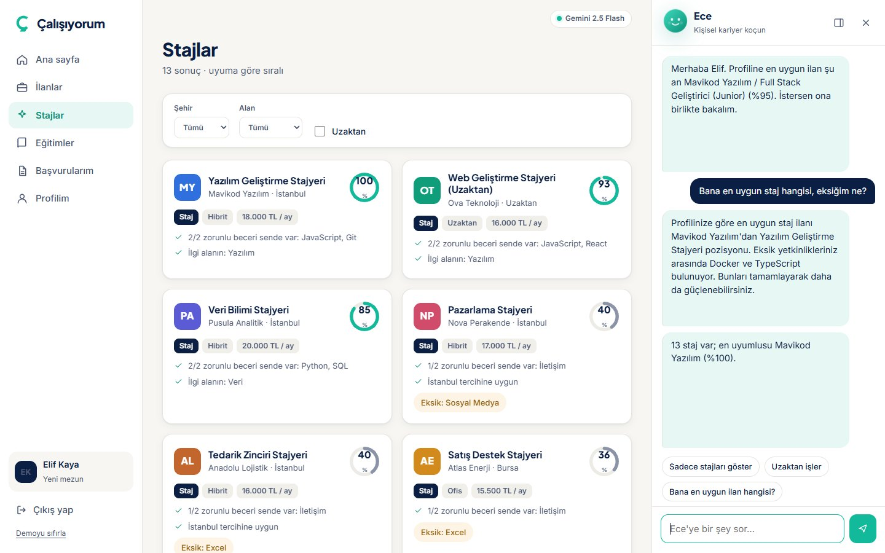</p>

### 5. İlanlar ve ilan detayı

Her ilan kartında uyum skoru, sende olan zorunlu beceriler ve eksik beceriler görünür. Detay sayfasında skor; beceri, seviye ve konum diye ayrılır.

<table>
  <tr>
    <td></td>
    <td></td>
  </tr>
</table>

### 6. Eğitimler ve başvurular

Eksik becerileri kapatan eğitimler önerilir. Başvuruların durumu (İnceleniyor, Mülakat…) tek ekranda takip edilir.

<table>
  <tr>
    <td></td>
    <td>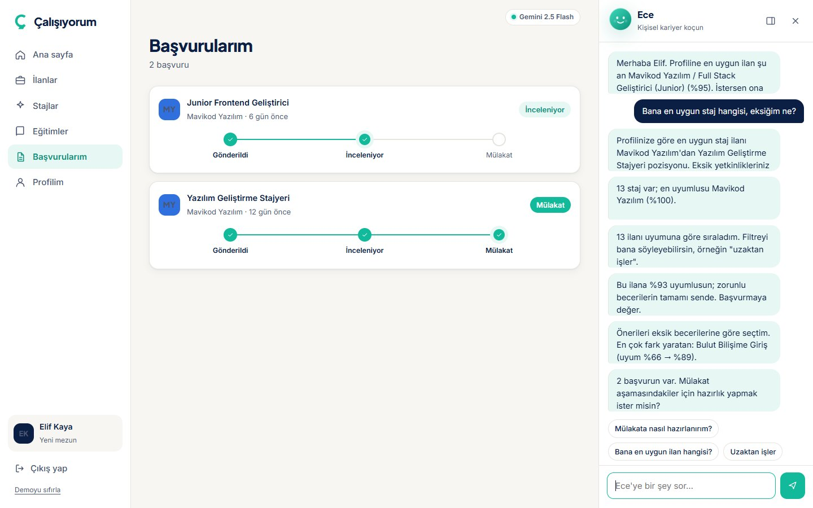</td>
  </tr>
</table>

### 7. Telefonda

Arayüz telefona uyumludur: alt menü, açılır koç düğmesi.

<p align="center">
  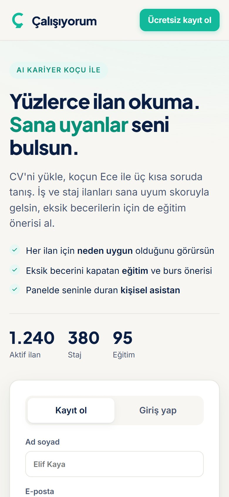
  &nbsp;&nbsp;
  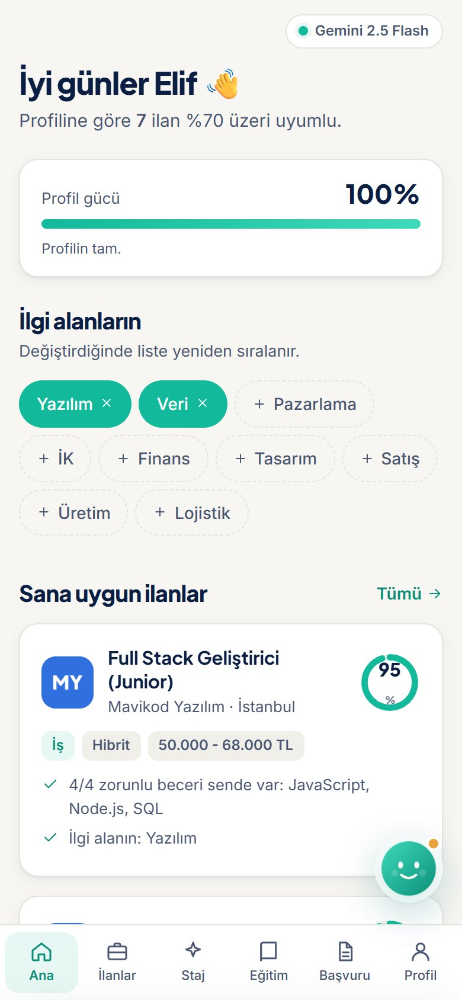
</p>

## Sunum

Yatırımcı, jüri, İK, sponsor ve okullar için hazırlanmış 14 slaytlık Türkçe sunum.

- **PDF:** [`sunum/calisiyorum-sunum.pdf`](sunum/calisiyorum-sunum.pdf)
- **Animasyonlu HTML:** `sunum/index.html` dosyasını tarayıcıda açın. Ok tuşları veya boşluk ile ilerlenir, `#5` gibi bir adresle doğrudan slayta gidilir.
- **İkinci sürüm:** `sunum-claude/` (aynı akışın farklı tasarımı, slayt başına bir HTML dosyası).

<p align="center">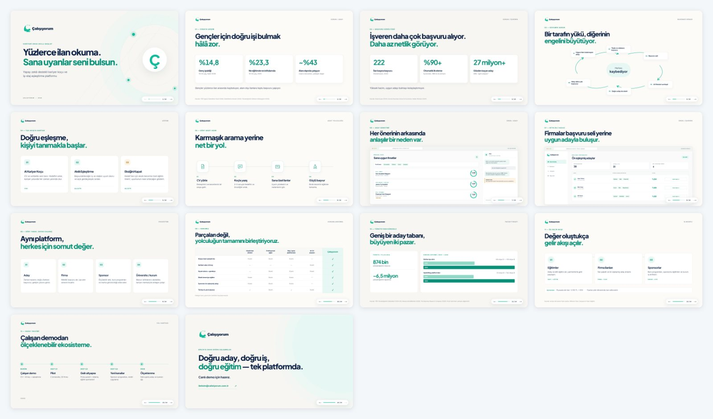</p>

<details>
<summary><b>Slaytları tek tek gör</b></summary>

| | |
|---|---|
| 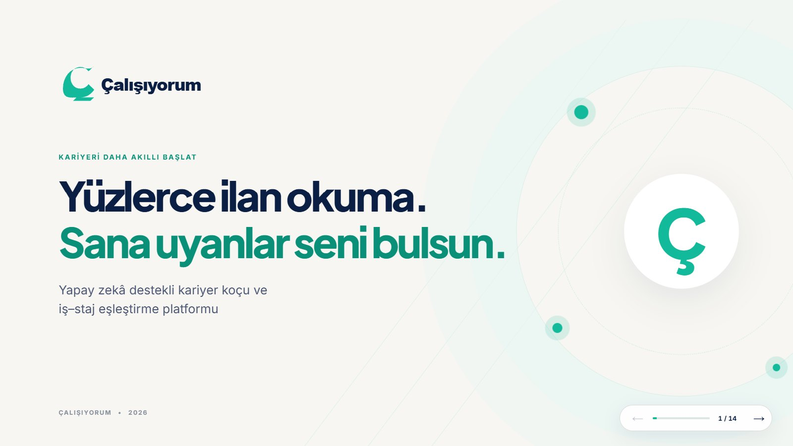 |  |
| 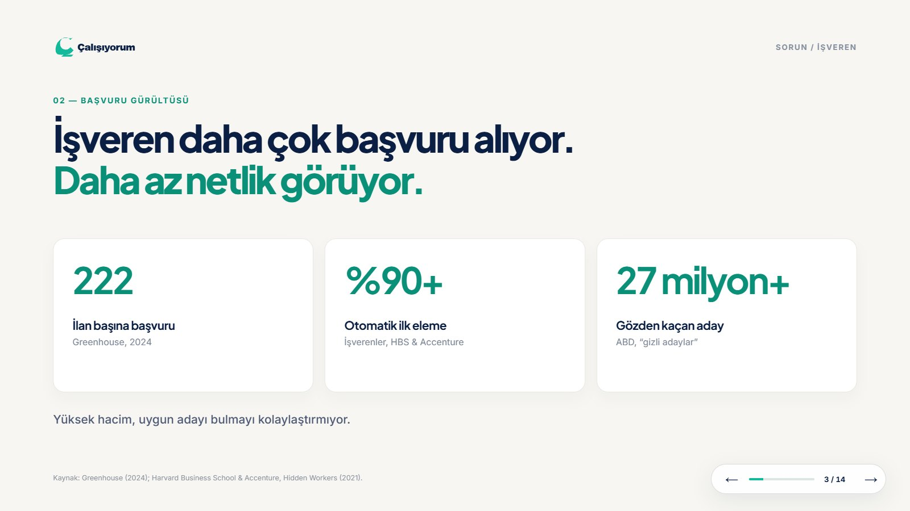 | 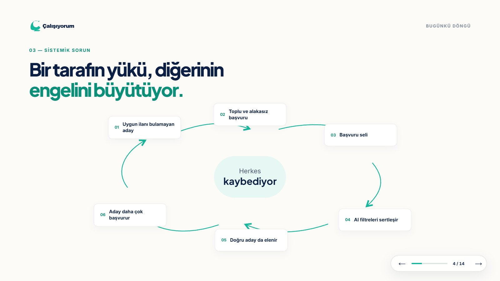 |
| 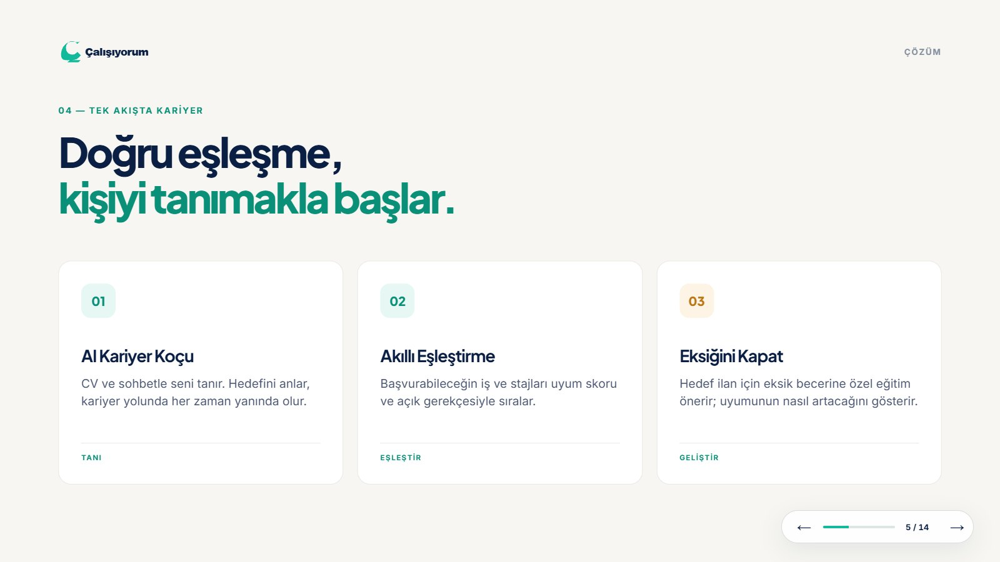 | 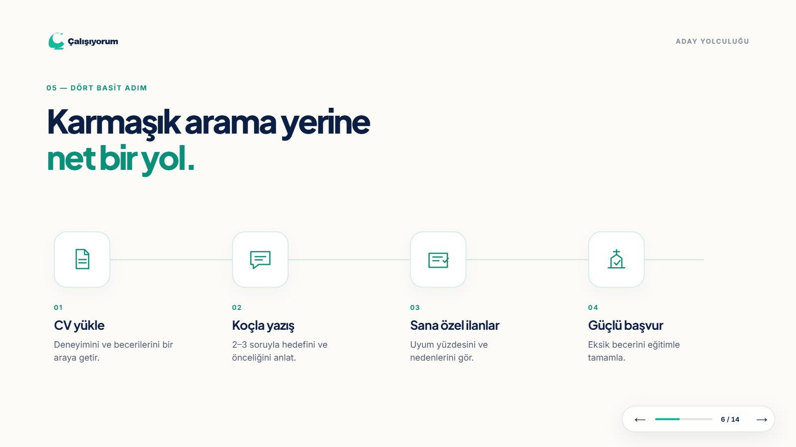 |
|  | 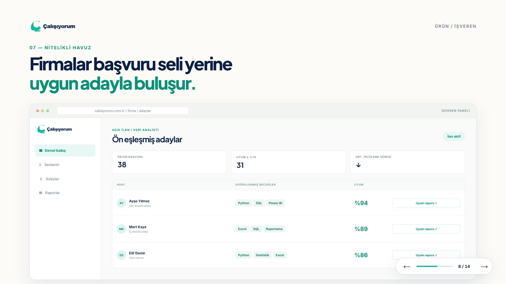 |
| 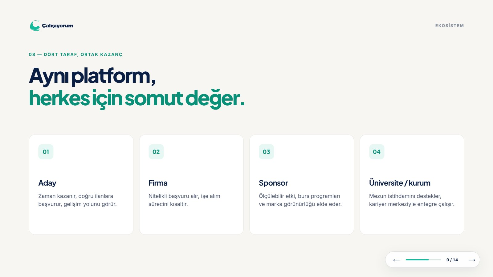 |  |
| 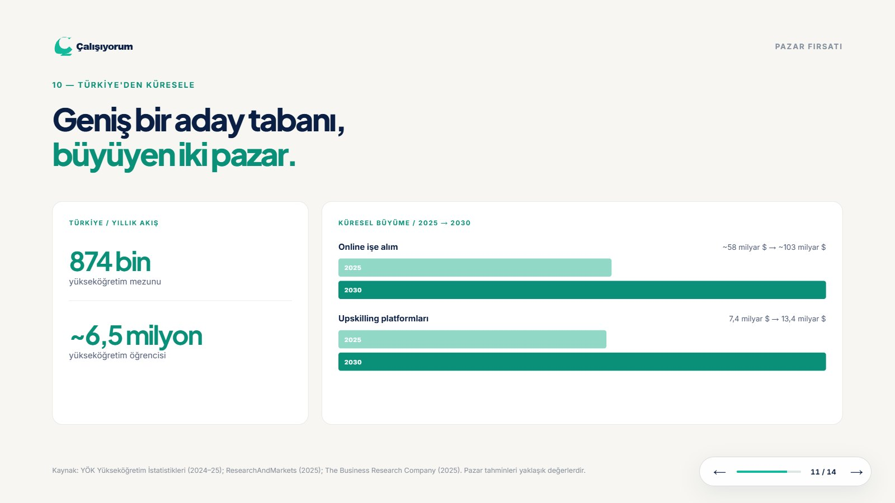 | 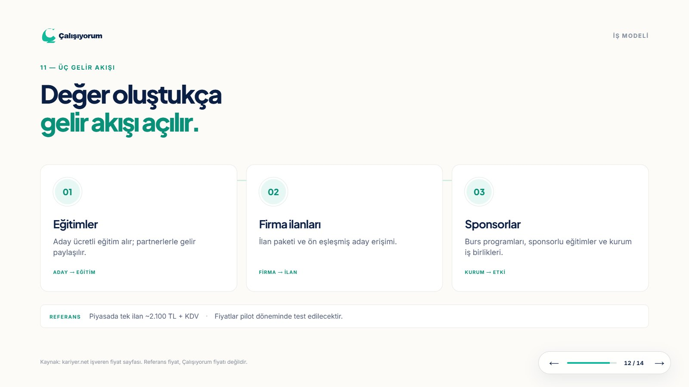 |
|  | 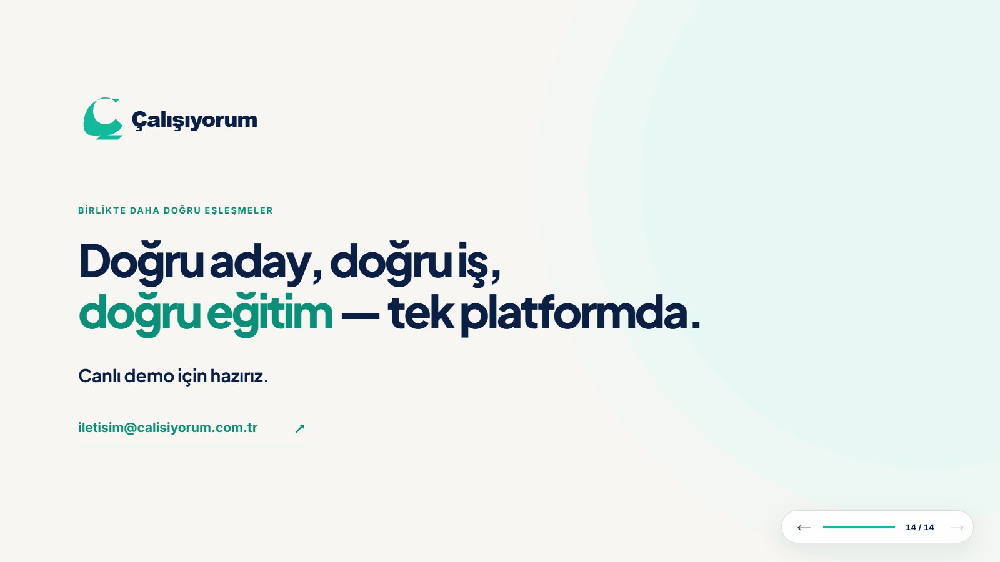 |

</details>

> Sunumdaki pazar ve istatistik verilerinin kaynakları `docs/BULGULAR.md` içinde. Bir kısmı henüz resmî kaynaktan doğrulanmadı.

## Teknik yapı

```
calisiyorum/
├── demo2/          # Yayındaki ürün demosu (kayıt → CV → koç → panel)
│   ├── server.js   # Sıfır bağımlılıklı Node sunucusu + Gemini proxy
│   ├── Dockerfile
│   └── public/     # Saf HTML/CSS/JS (ES modülleri, hash router)
├── demo/           # İlk demo (tek akış)
├── sunum/          # 14 slayt HTML sunum + PDF
├── sunum-claude/   # Sunumun ikinci sürümü
├── marka/          # Logo
└── docs/           # DURUM, PRD (ürün kararları), BULGULAR (kaynaklar), ekran görüntüleri
```

- **Paket yok:** Sunucu Node'un yerleşik modülleriyle çalışır, `npm install` gerekmez.
- **Anahtar sunucuda kalır:** Tarayıcı yalnız `/api/coach` adresine istek atar. Gemini anahtarı tarayıcıya gitmez.
- **Yedek model:** Ana model hata verirse `GEMINI_FALLBACK_MODEL` denenir. O da olmazsa arayüz yerel senaryoyla ("Demo modu") aynı akışı sürdürür.
- **Durum tarayıcıda:** Kullanıcı verisi `localStorage`'da tutulur. "Demoyu sıfırla" bağlantısı temizler.
- **Sağlık kontrolü:** `GET /api/status` → `{"ai":true,"model":"Gemini 2.5 Flash"}`

## Yerelde çalıştırma

Node 22 veya üstü gerekir.

```bash
git clone https://github.com/gunhanmehmetakif/calisiyorum.git
cd calisiyorum
cp demo2/.env.example demo2/.env   # GEMINI_API_KEY değerini girin (isteğe bağlı)
node demo2/server.js
```

Ardından http://localhost:5174 adresini açın. Anahtar girilmezse demo, yerel senaryoyla çalışır.

| Değişken | Varsayılan | Açıklama |
|---|---|---|
| `GEMINI_API_KEY` | — | Google AI Studio anahtarı. Yalnız `.env` dosyasında veya sunucu ortamında tutulur, repoya girmez. |
| `GEMINI_MODEL` | `gemini-2.5-flash` | Ana model |
| `GEMINI_FALLBACK_MODEL` | `gemini-3.5-flash-lite` | Ana model hata verirse denenecek model |
| `DEMO2_PORT` | `5174` | Port (Docker imajında 3000) |

## Yayın (Coolify)

| Ayar | Değer |
|---|---|
| Kaynak | Bu repo, `main` dalı (GitHub App) |
| Base directory | `/demo2` |
| Build pack | Dockerfile |
| Port | 3000 |
| Sağlık kontrolü | `/api/status` |
| Ortam değişkenleri | `GEMINI_API_KEY`, `GEMINI_MODEL`, `GEMINI_FALLBACK_MODEL` (çalışma anı) |
| Domain | https://calisiyorum.mehmetakifgunhan.com |

`main` dalına yapılan push sonrası Coolify uygulamayı yeniden derler.

## Ekip

<table>
  <tr>
    <td align="center">
      <a href="https://github.com/gunhanmehmetakif"><br><b>Mehmet Akif Günhan</b></a>
    </td>
    <td align="center">
      <a href="https://github.com/ndonmez0922-gif"><br><b>Nuriyenaz Dönmez</b></a>
    </td>
  </tr>
</table>

---

<sub>© 2026 Çalışıyorum. Demo amaçlıdır; ilanlar, firmalar, eğitimler ve kişiler kurgusaldır.</sub>
