<a href="https://calisiyorum.mehmetakifgunhan.com">
  <picture>
    <source media="(prefers-color-scheme: dark)" srcset="docs/readme/banner-dark.png">
    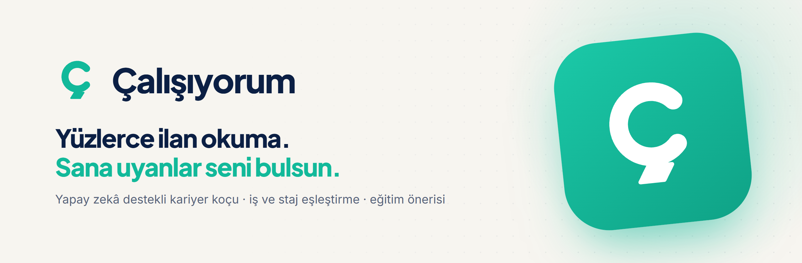
  </picture>
</a>

<p align="center">
  <a href="https://calisiyorum.mehmetakifgunhan.com"></a>
  <a href="sunum/calisiyorum-sunum.pdf"></a>
</p>

<p align="center">
  
  
  
  
  
</p>

<p align="center">
  <a href="#neden">Neden</a> ·
  <a href="#nasıl-çalışır">Nasıl çalışır</a> ·
  <a href="#ürün">Ürün</a> ·
  <a href="#sunum">Sunum</a> ·
  <a href="#mimari">Mimari</a> ·
  <a href="#hızlı-başlangıç">Hızlı başlangıç</a> ·
  <a href="#yol-haritası">Yol haritası</a> ·
  <a href="#ekip">Ekip</a>
</p>

<br>

<p align="center">
  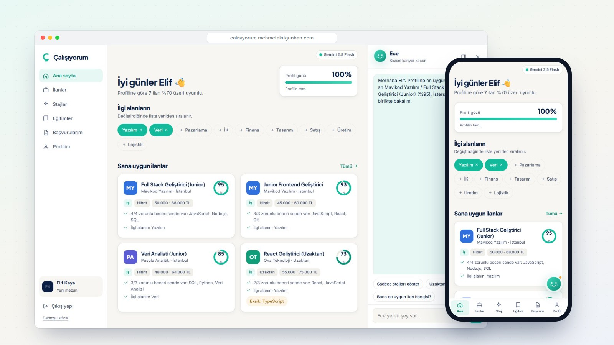
</p>

## Neden

Gençler ve yeni mezunlar yüzlerce ilanı tek tek okuyup toplu başvuru yapıyor. Firmalar başvuru seli içinde uygun adayı bulamıyor. İki tarafın sorunu birbirini büyütüyor.

<table>
  <tr>
    <th width="50%">Aday</th>
    <th width="50%">İşveren</th>
  </tr>
  <tr>
    <td>Hangi ilana gerçekten uygun olduğunu bilmiyor. Eksik becerisini neyle kapatacağını bilmiyor.</td>
    <td>Çok başvuru alıyor, az uygun aday görüyor. Eleme zaman ve para kaybettiriyor.</td>
  </tr>
  <tr>
    <td><b>Çalışıyorum:</b> CV'yi okuyan, adayı tanıyan bir koç. Her ilan için uyum skoru ve gerekçe. Eksik beceriye eğitim.</td>
    <td><b>Çalışıyorum:</b> Başvuru seli yerine ön eşleşmiş, uygun adaylar.</td>
  </tr>
</table>

## Nasıl çalışır

Kayıttan kişisel panele birkaç dakikada: CV yüklenir, beceriler çıkarılır, koç **Ece** üç kısa soruyla hedefi, şehri ve iş tipini öğrenir.

<p align="center">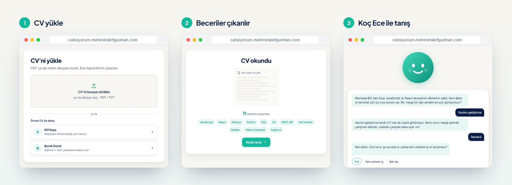</p>

## Ürün

### Gerekçeli eşleştirme

Her ilan uyum skoruyla sıralanır ve **neden uygun olduğu** yazar: sende olan zorunlu beceriler, seviye, konum. Eksik beceri varsa onu kapatan eğitim önerilir.

<p align="center">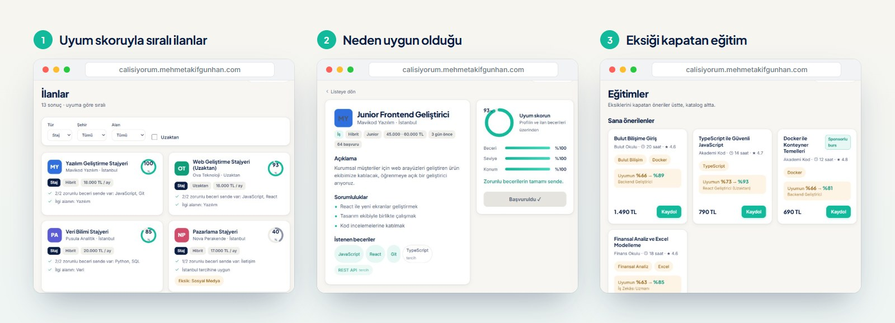</p>

### Her zaman yanında bir kariyer koçu

Ece panelin sağında hep açık durur. Aday doğal dille sorar, Ece profilini bilerek cevap verir ve gerekirse ilgili sayfayı kendisi açar.

<p align="center">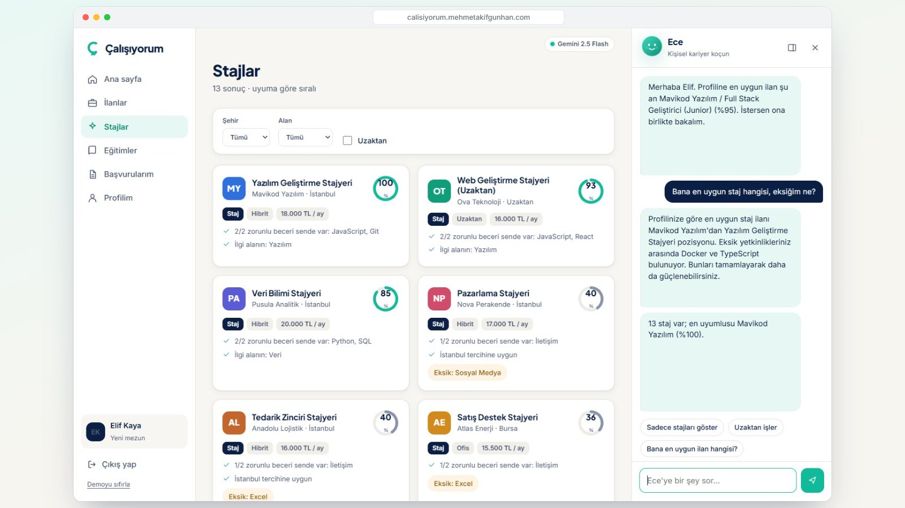</p>

> **Aday:** Bana en uygun staj hangisi, eksiğim ne?<br>
> **Ece:** Profilinize göre en uygun staj ilanı Mavikod Yazılım'dan Yazılım Geliştirme Stajyeri pozisyonu. Eksik yetkinlikleriniz arasında Docker ve TypeScript bulunuyor. Bunları tamamlayarak daha da güçlenebilirsiniz.
>
> <sub>Canlı demodan, Gemini 2.5 Flash cevabı.</sub>

### Telefonda da aynı deneyim

<p align="center">
  
  &nbsp;&nbsp;&nbsp;
  
</p>

<details>
<summary><b>Bütün ekranlar</b></summary>
<br>

| | |
|---|---|
|  | 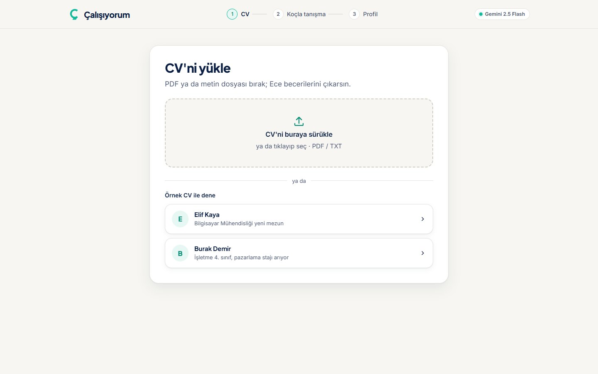 |
| 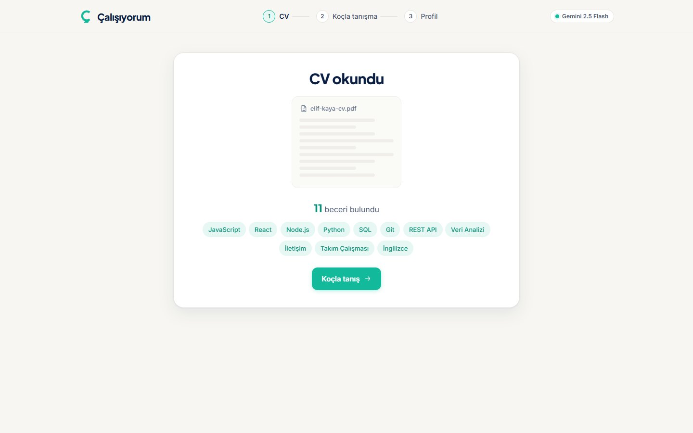 | 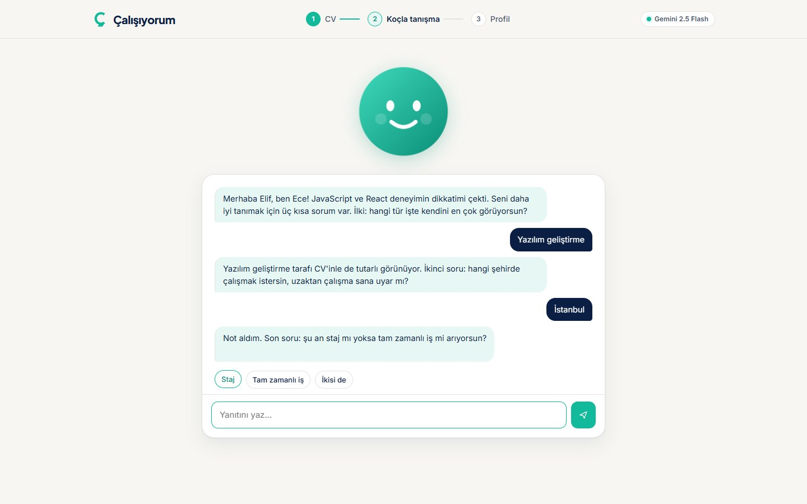 |
| 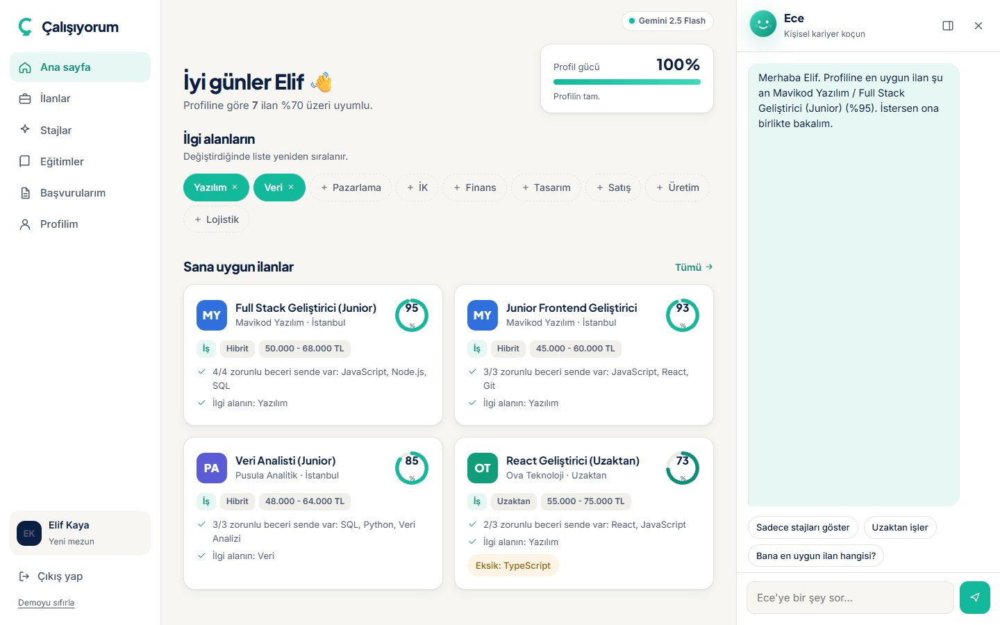 |  |
| 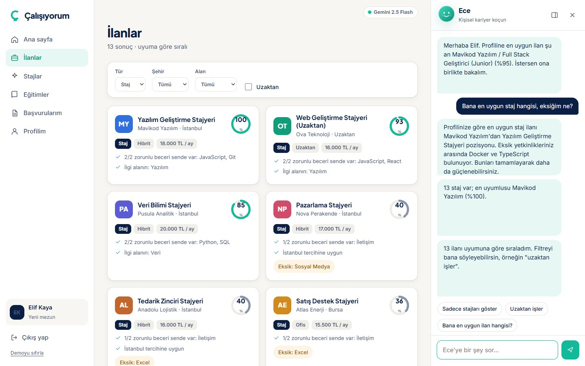 | 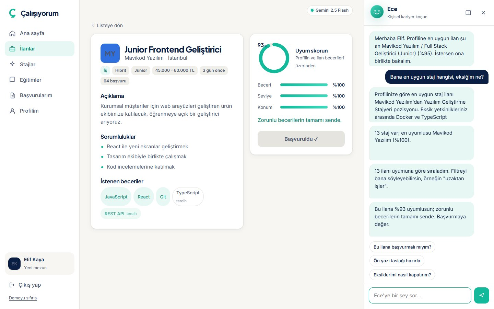 |
| 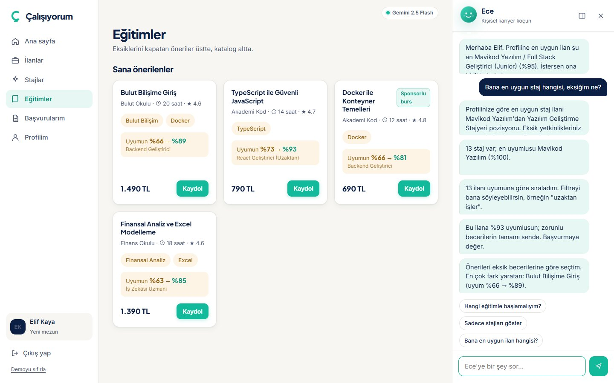 |  |

</details>

## Neyi farklı yapıyoruz

| | İlan siteleri | Profesyonel ağlar | Genç platformları | AI CV araçları | **Çalışıyorum** |
|---|:-:|:-:|:-:|:-:|:-:|
| Kişiye özel eşleştirme | Kısmi | Kısmi | Kısmi | — | ✅ |
| Sohbet eden AI koç | — | — | — | Kısmi | ✅ |
| Uyum skoru ve gerekçe | — | Kısmi | Kısmi | Kısmi | ✅ |
| Eksik beceriye eğitim | Kısmi | Kısmi | Kısmi | — | ✅ |
| İşverene ön eşleşmiş aday | Kısmi | Kısmi | Kısmi | — | ✅ |
| Türkçe ve yerel piyasa | ✅ | Kısmi | ✅ | Kısmi | ✅ |

<sub>Kategori bazlı, genel ürün özellikleri karşılaştırmasıdır.</sub>

**Gelir modeli:** ücretli eğitimler (partnerlerle gelir paylaşımı) · firma ilan paketleri ve ön eşleşmiş aday erişimi · sponsorlu burs ve eğitim programları.

## Sunum

Yatırımcı, jüri, İK, sponsor ve üniversiteler için 14 slaytlık Türkçe sunum.

<p align="center"><a href="sunum/calisiyorum-sunum.pdf">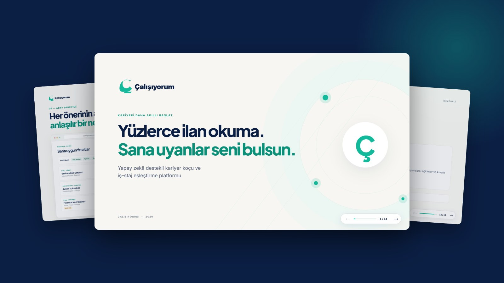</a></p>

<p align="center">
  <a href="sunum/calisiyorum-sunum.pdf"><b>PDF'i aç</b></a> ·
  Animasyonlu sürüm: <code>sunum/index.html</code> (← → ile gezin, <code>#5</code> ile slayta git)
</p>

<details>
<summary><b>Bütün slaytlar</b></summary>
<br>

| | |
|---|---|
|  | 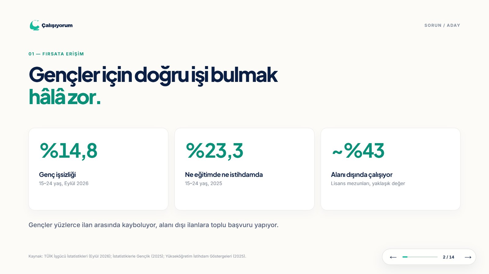 |
|  |  |
|  |  |
| 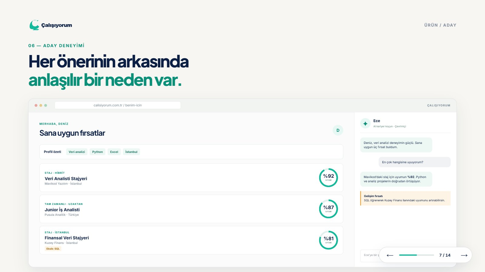 |  |
|  | 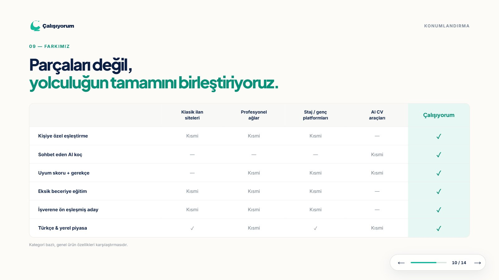 |
|  |  |
| 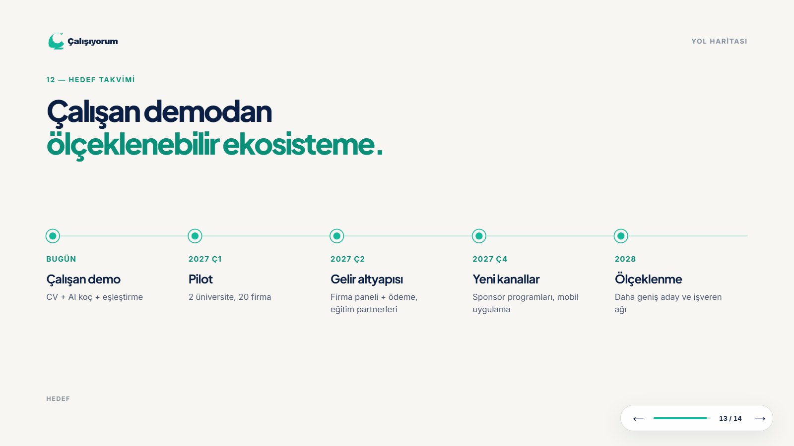 |  |

<sub>Pazar ve istatistik verilerinin kaynakları <code>docs/BULGULAR.md</code> içinde; bir kısmı henüz resmî kaynaktan doğrulanmadı.</sub>

</details>

## Mimari

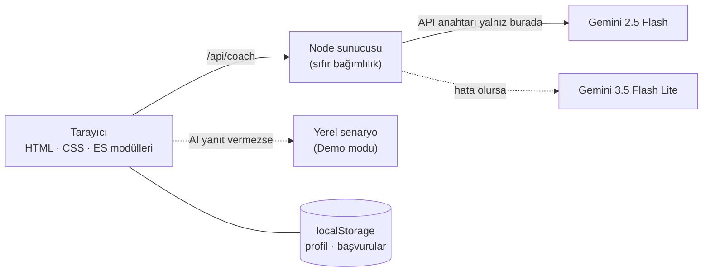

- **Anahtar tarayıcıya gitmez.** Tarayıcı yalnız kendi sunucusuyla konuşur, Gemini çağrısını sunucu yapar.
- **Kesintiye dayanıklı.** Ana model hata verirse yedek model denenir. O da yoksa arayüz aynı akışı yerel senaryoyla sürdürür.
- **Paket yok.** Sunucu Node'un yerleşik modülleriyle çalışır. `npm install` gerekmez, imaj küçük kalır.
- **Sağlık kontrolü:** `GET /api/status` → `{"ai":true,"model":"Gemini 2.5 Flash"}`

<details>
<summary><b>Klasör yapısı</b></summary>

```
calisiyorum/
├── demo2/            Yayındaki ürün (kayıt → CV → koç → panel)
│   ├── server.js     Node sunucusu + Gemini proxy
│   ├── Dockerfile
│   └── public/       Arayüz (hash router, ES modülleri)
├── demo/             İlk prototip (tek akış)
├── sunum/            14 slayt HTML sunum + PDF
├── sunum-claude/     Sunumun alternatif tasarımı
├── marka/            Logo ve işaret (SVG)
└── docs/             PRD, durum, kaynaklar, README görselleri
```

</details>

## Hızlı başlangıç

Node 22 veya üstü yeterli.

```bash
git clone https://github.com/gunhanmehmetakif/calisiyorum.git
cd calisiyorum
cp demo2/.env.example demo2/.env    # GEMINI_API_KEY girin (isteğe bağlı)
node demo2/server.js                # http://localhost:5174
```

Anahtar girilmezse demo yerel senaryoyla çalışır.

| Değişken | Varsayılan | Açıklama |
|---|---|---|
| `GEMINI_API_KEY` | — | Google AI Studio anahtarı. Yalnız `.env` dosyasında veya sunucu ortamında tutulur. |
| `GEMINI_MODEL` | `gemini-2.5-flash` | Ana model |
| `GEMINI_FALLBACK_MODEL` | `gemini-3.5-flash-lite` | Yedek model |
| `DEMO2_PORT` | `5174` | Port (Docker imajında `3000`) |

<details>
<summary><b>Yayın (Coolify)</b></summary>
<br>

| Ayar | Değer |
|---|---|
| Kaynak | Bu repo, `main` dalı (GitHub App, push ile otomatik yayın) |
| Base directory | `/demo2` |
| Build pack | Dockerfile |
| Port | `3000` |
| Sağlık kontrolü | `/api/status` |
| Ortam değişkenleri | `GEMINI_API_KEY`, `GEMINI_MODEL`, `GEMINI_FALLBACK_MODEL` |
| Domain | https://calisiyorum.mehmetakifgunhan.com |

</details>

## Yol haritası

| Ne zaman | Adım | Kapsam |
|---|---|---|
| **Bugün** | ✅ Çalışan demo | CV okuma, AI koç, gerekçeli eşleştirme, eğitim önerisi |
| 2027 Ç1 | Pilot | 2 üniversite, 20 firma |
| 2027 Ç2 | Gelir altyapısı | Firma paneli, ödeme, eğitim partnerleri |
| 2027 Ç4 | Yeni kanallar | Sponsor programları, mobil uygulama |
| 2028 | Ölçeklenme | Daha geniş aday ve işveren ağı |

## Ekip

<table>
  <tr>
    <td align="center" width="180">
      <a href="https://github.com/gunhanmehmetakif"><br><b>Mehmet Akif Günhan</b></a><br>
      <sub>@gunhanmehmetakif</sub>
    </td>
    <td align="center" width="180">
      <a href="https://github.com/ndonmez0922-gif"><br><b>Nuriyenaz Dönmez</b></a><br>
      <sub>@ndonmez0922-gif</sub>
    </td>
  </tr>
</table>

---

<p align="center">
  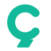<br>
  <sub>© 2026 Çalışıyorum · Demo amaçlıdır; ilanlar, firmalar, eğitimler ve kişiler kurgusaldır.Şuan da bu konu geliştirme aşamasındadır.</sub>
</p>
